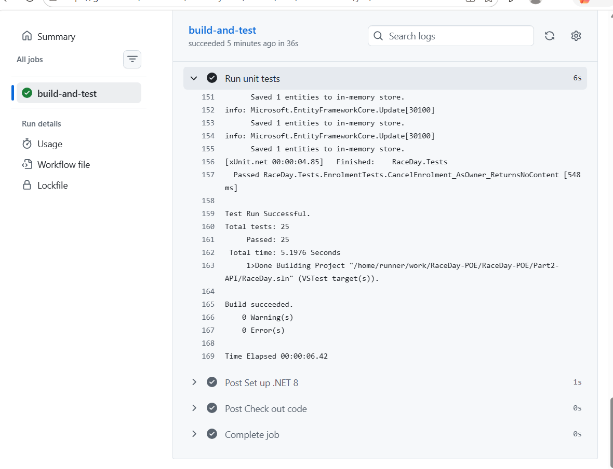

# RaceDay

RaceDay is a full-stack event management system for the South African road running, walking, and cycling community. Event Organisers can create and manage events, categories, routes, and results, while Participants can browse events, enter events, track their enrolments, and view their personal result history.

## Roles

* **Organiser** — can create, edit, and delete events, manage event categories and routes, capture participant results, and view all event enrolments.
* **Participant** — can create an account, browse events, enter an event by selecting a category, view their own enrolments, and track their own results.

## Part 1 — Planning (this submission)

This part contains the planning documents for the system, all inside `/docs`:

* `docs/raceday\\\_erd.png` — Entity Relationship Diagram (6 entities: Users, Events, Categories, Routes, EventEnrolments, Results)
* `docs/endpoint\\\_plan.md` — Full API endpoint plan covering Authentication, User Profile, Events, Categories, Routes, Enrolments, and Results
* `docs/raceday\\\_schema.sql` — SQL Server script creating the full schema with sample data (2 Organisers, 2 Participants, 3 Events, categories, and enrolments)

No API code has been written in this part, per the brief.

## CI/CD

!\[CI/CD passing](docs/cicd-success.png)

## Video

https://youtu.be/yDgAZ5eMQUs


# Part 2: RaceDay REST API

An ASP.NET Core Web API (.NET 8) for managing running, walking and cycling events. It uses Entity Framework Core (Code-First) with SQL Server, session-based authentication, BCrypt password hashing, and role-based access control.

## Setup and running

1. Install the .NET 8 SDK, Visual Studio 2022 and SQL Server (Express is fine).
2. Clone the repository and switch to the `part2-api` branch:
```
   git clone https://github.com/KaraboBali/RaceDay-POE.git
   git checkout part2-api
```
3. Open `Part2-API/RaceDay.sln` in Visual Studio.
4. In `Part2-API/RaceDay.Api/appsettings.json`, set the connection string to match your SQL Server instance (the default is `localhost\SQLEXPRESS` with Windows authentication).
5. Create the database. In the Package Manager Console, with **RaceDay.Api** as the default project:
```
   Update-Database
```
6. Run the **RaceDay.Api** project (https profile). Swagger opens at `https://localhost:7141/swagger`.

## Roles

| Role | What they can do |
|------|------------------|
| **Organiser** | Create, edit and delete their own events, categories and results. View enrolments for their own events and look up users by id. |
| **Participant** | Browse events, enrol in a category, view and cancel their own enrolments, and view their own results. |

Both roles can register, log in, log out, and view or update their own profile. Passwords are stored as BCrypt hashes.

## Authentication

Login creates a server-side session (HttpOnly cookie). Endpoints return **401** when no one is logged in and **403** when the logged-in role is not allowed. In Swagger, log in via `POST /api/auth/login` first and the same browser session is used for later calls.

## Main endpoints

| Area | Endpoint | Who |
|------|----------|-----|
| Auth | `POST /api/auth/register`, `POST /api/auth/login`, `POST /api/auth/logout` | Anyone |
| Profile | `GET/PUT /api/users/me` | Logged in |
| Users | `GET /api/users/{id}` | Organiser |
| Events | `GET /api/events`, `GET /api/events/{id}` | Logged in |
| Events | `POST /api/events`, `PUT/DELETE /api/events/{id}` | Organiser (owner) |
| Categories | `GET/POST /api/events/{eventId}/categories`, `PUT/DELETE /api/categories/{id}` | Read: logged in, write: Organiser |
| Enrolments | `POST /api/categories/{categoryId}/enrolments`, `GET /api/enrolments/mine`, `DELETE /api/enrolments/{id}` | Participant |
| Enrolments | `GET /api/events/{eventId}/enrolments` | Organiser (owner) |
| Results | `POST /api/enrolments/{enrolmentId}/result`, `PUT /api/results/{id}`, `GET /api/events/{eventId}/results` | Organiser (owner) |
| Results | `GET /api/results/mine` | Participant |

## Deviation from the Part 1 ERD

The `Events` table gained an **EventType** column (`Run`, `Walk` or `Cycle`) that was not in the original Part 1 ERD. A race day can be a run, a walk or a cycle, and the type is needed to show and filter events properly.

## Unit tests

The `RaceDay.Tests` project (xUnit with an in-memory database) contains **25 tests** covering:

- registration and login, including success, wrong password, unknown email, duplicate email and missing details
- event management for success, not found, not logged in, and wrong role or wrong owner
- role-based rejection (Participant blocked from Organiser endpoints, and the reverse)
- enrolments, including success, duplicate enrolment, wrong role, and unknown category

Run them with:
```
dotnet test Part2-API/RaceDay.sln
```

## CI/CD

A GitHub Actions workflow (`.github/workflows/dotnet.yml`) restores, builds and runs all tests on every push to `part2-api`.



## Demo video

YouTube (unlisted): *link to be added*
[Part 1 video walkthrough](PASTE_YOUTUBE_LINK_HERE)

## Setup Instructions

<!-- Fill in once Part 2/3 add real setup steps, e.g. connection strings, running migrations, etc. -->

1. Clone the repository.
2. Open `docs/raceday\\\_schema.sql` in SQL Server Management Studio and run it against a clean database to create the schema and sample data.

